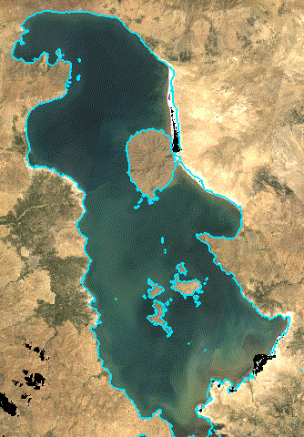
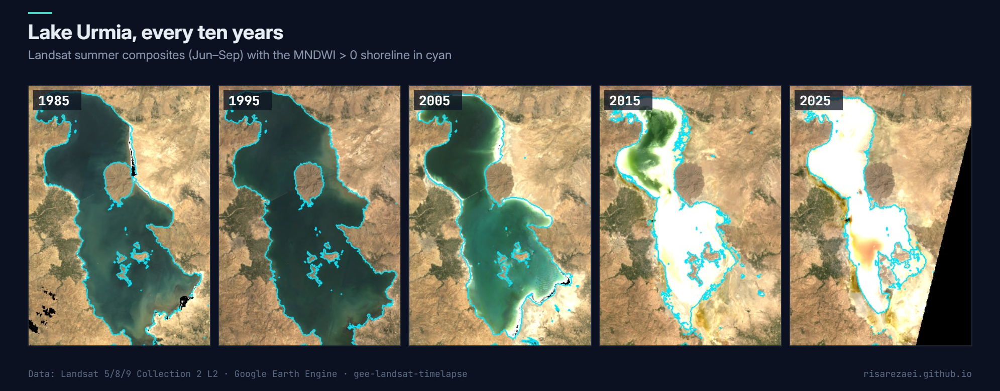

# Landsat Timelapse for Lakes and Wetlands

Turn 40 years of Landsat into an **animated GIF** of any lake, wetland, river or coast. You get one cloud-free summer composite per year, with an optional **shoreline outline** so the change is easy to follow. It works well for talks, reports and social media.

Example output for Lake Urmia with the default settings: one frame per summer, 1985–2025 (2012 has no Landsat 5/8 data and is skipped).

## What the script does

- Merges **Landsat 5, 8 and 9** Collection 2 surface reflectance (Landsat 7 optional) and masks clouds and shadows.
- Keeps the **clearest scenes of each WRS path** every year, so areas that span two paths stay complete and long animations stay within memory limits.
- Builds a **median composite** per year, in natural colour or SWIR-NIR-green false colour.
- Draws the **water edge** (MNDWI > 0) on every frame.
- Shows the animation in the Console with a **download link to the GIF**, and can export an **MP4** to Google Drive.

## Quick start

1. Open the [Earth Engine Code Editor](https://code.earthengine.google.com).
2. Paste [`landsat_timelapse.js`](landsat_timelapse.js) into a new script.
3. Set `roi` and the years in `CONFIG`.
4. Press **Run** and click *Open / download the GIF* in the Console.

## Configuration

| Parameter | Default | Description |
|---|---|---|
| `roi` | Lake Urmia | Area to animate |
| `firstYear` / `lastYear` / `step` | 1985 / 2025 / 1 | Frames |
| `season` | `['06-01', '09-30']` | Month-day window of each composite |
| `maxSceneCloud` | `60` | Scenes above this cloud cover (%) are skipped |
| `maxScenesPerPath` | `6` | Clearest scenes kept per WRS path and year |
| `useLandsat7` | `false` | Add Landsat 7 (fills 2012, but adds stripes after 2003) |
| `display` | `'natural'` | `'natural'` or `'false'` colour |
| `outlineWater` | `true` | Draw the MNDWI > 0 shoreline |
| `dimensions` | `600` | Longest side of the GIF in pixels |
| `framesPerSecond` | `4` | Animation speed |
| `exportVideo` | `false` | Also export an MP4 to Drive |

## Tips

- For a very large area, lower `dimensions` or `maxScenesPerPath` if you get a "memory limit exceeded" message.
- Use `display: 'false'` for wetlands: vegetation turns green and open water turns dark blue.
- The GIF link expires after a few hours; download the file if you want to keep it.

## Cite this tool

Abbasalizadehrezaei, P. (2026). *Landsat Timelapse for Lakes and Wetlands* (Version 1.0.0) [Software]. Zenodo. https://doi.org/10.5281/zenodo.23646377

GitHub also offers a ready-made citation under **Cite this repository** (from [CITATION.cff](CITATION.cff)).

## Author

**Parisa Abbasalizadehrezaei** · [risarezaei.github.io](https://risarezaei.github.io)

Released under the [MIT License](LICENSE).
